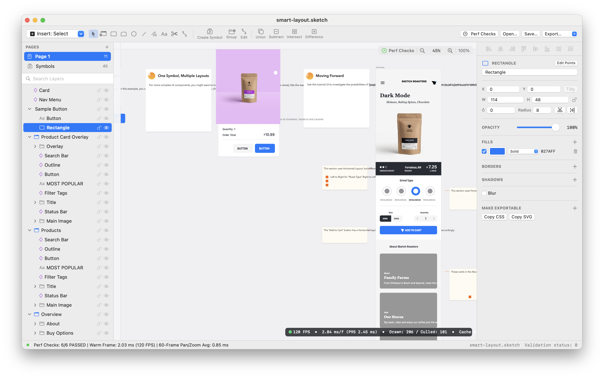
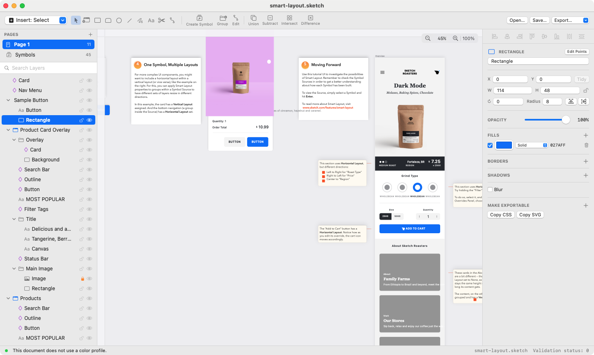
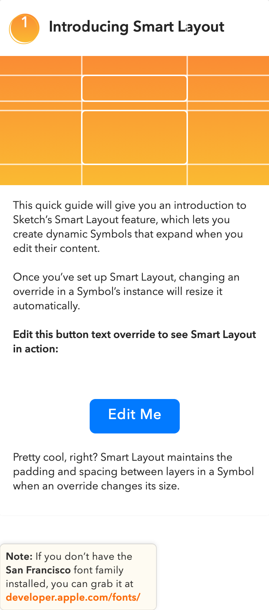

# OpenSketch

**OpenSketch** is an open-source, clean-room vector design application and command-line toolkit for **macOS** (Swift / AppKit / CoreGraphics) and **Windows** (Rust) that opens, validates, repairs, edits, and exports `.sketch` (`v139`) design documents.



---

## What OpenSketch Does

- **Open, Validate & Repair `.sketch` Files**: Reads modern ZIP-based `.sketch` archives (`v139`), detects version incompatibilities or missing metadata (`meta.json` / `user.json`), and automatically repairs recoverable archives that would otherwise fail to open.
- **Interactive Vector Canvas & Layer Tree**: Browse pages and nested layer hierarchies, pan and zoom across multi-artboard documents, toggle visibility/locks, and inspect properties in a desktop studio UI.
- **Create & Edit Vector Shapes**: Draw and modify rectangles, rounded cards, ovals, polygons, stars, triangles, text layers, and artboards; edit Bezier curve points and corner radii; combine shapes with boolean operations (**Union**, **Subtract**, **Intersect**, **Difference**); and apply sibling clipping masks.
- **Evaluate Symbols & Smart Layout**: Expand `symbolMaster` / `symbolInstance` hierarchies with live text overrides (`_stringValue`) and automatic horizontal/vertical Smart Layout resizing.
- **Export to Standard Formats**: Export artboards, pages, or individual layers to **SVG**, **PNG** (`@1x` / `@2x`), **Vector PDF**, and **CSS** declarations from either the GUI or the CLI.

### Workspace & Export Previews

| Studio Workspace (`samples/smart-layout.sketch`) | Exported Artboard Render (`out/opensketch-exported.png`) |
|---|---|
|  |  |

---

## Quick Start

### macOS (`OpenSketch/` — Swift 5.10, Zero External Dependencies)

```bash
# 1. Run the 9-test verification suite
swift test --package-path OpenSketch

# 2. Inspect, validate, or export a .sketch file from the CLI
swift run --package-path OpenSketch opensketch-cli inspect samples/smart-layout.sketch
swift run --package-path OpenSketch opensketch-cli export-svg samples/smart-layout.sketch out/exported.svg

# 3. Build and run the native macOS app
swift build -c release --package-path OpenSketch
```

### Windows & Cross-Platform (`OpenSketchWindows/` — Rust)

```bash
# 1. Run the 9-test verification suite
cargo test --release --manifest-path OpenSketchWindows/Cargo.toml

# 2. Inspect, validate, or export a .sketch file from the CLI
cargo run --release --manifest-path OpenSketchWindows/Cargo.toml --bin opensketch-win-cli -- inspect samples/smart-layout.sketch

# 3. Launch the desktop studio
cargo run --release --manifest-path OpenSketchWindows/Cargo.toml --bin opensketch-windows -- samples/smart-layout.sketch
```

---

## How It Works

OpenSketch was built by studying how `.sketch` (`v139` / `0x8b`) documents are structured and processed, then implementing a clean-room engine in Swift (`OpenSketchCore`) and Rust (`opensketch_win_core`):

1. **Archive & Validation Pipeline (`SketchDocumentIO`)**:
   - Inspects the first 4 bytes of a file (`PK\x03\x04` for ZIP JSON archives vs. `SQLi` for legacy SQLite documents).
   - Parses `meta.json`, `user.json`, `document.json`, and `pages/<UUID>.json`, preserving unknown JSON fields for lossless round-trip saving.
   - Implements the 5-state validation machine (`0` valid, `2` missing metadata, `3` legacy `<= 87`, `4` newer version warning, `5` incompatible `compatibilityVersion > 139`) and fixes a nil-data crash when `user.json` is absent (`samples/variants/v2-no-user-json.sketch`).
2. **Vector Geometry & Boolean Engine (`SketchGeometry`)**:
   - Converts normalized `[0..1]` unit curve points into canvas coordinates and constructs cubic Bezier segments and rounded-corner fillets (using the cubic arc handle weight `0.4477152502`).
   - Evaluates polygon boolean operations (`Union`, `Subtract`, `Intersect`, `Difference`) and Smart Layout (`MSImmutableInferredGroupLayout`) symbol override reflow.
3. **Cached Renderer & Exporters (`SketchRenderingEngine` / `render.rs`)**:
   - Caches decoded RGBA bitmaps, $O(1)$ `symbolMaster` lookups, expanded `symbolInstance` subtrees, and vector paths in `SketchRenderCache`, paired with viewport frustum culling (`visibleCanvasRect`).

### Documentation Map

| Document | Contents |
|---|---|
| **[`TECHNICAL_OVERVIEW.md`](TECHNICAL_OVERVIEW.md)** | **Short Technical Overview**: Architecture diagram, `.sketch` v139 archive schema, validation state table, Smart Layout rules, and render cache design |
| **[`FINDINGS.md`](FINDINGS.md)** | **Deep Research Log**: Detailed static/runtime analysis notes, predictions vs. observed behavior on crafted `.sketch` variants (`v0..v6`), and root-cause analysis |

---

## Measured Benchmark Results & Reproducible Test Conditions

OpenSketch includes an automated 6-check benchmark suite (`opensketch-cli bench` / `opensketch-win-cli bench`) used for regression testing.

> **Important Scope Note:** The numbers below are **measured benchmark results on a specific reference document (`samples/smart-layout.sketch`)**, not proof of sustained 120 FPS across all possible workloads. Very large documents with thousands of unculled complex boolean paths, uncached 4K bitmaps, or heavy multi-pass Gaussian blurs will incur higher frame times.

### Reproducible Test Environment
- **Reference Fixture**: [`samples/smart-layout.sketch`](samples/smart-layout.sketch) (1,105 KB PKZIP archive, **2 pages**, **46 `symbolMaster`s**, **312 rendered layers**, **14 embedded PNG bitmaps**).
- **Viewport & Camera**: `1440 × 900` logical viewport; 60-frame pan/zoom sweep from `0.75x` to `2.10x` zoom; `180 × 180` tight viewport for frustum culling.
- **Hardware & OS**: Apple M-series arm64, 24 GB unified memory, macOS 15.7.7 (`swift 5.10`, `rustc 1.94.0 --release`).
- **Commands to Reproduce**:
  ```bash
  swift run --package-path OpenSketch opensketch-cli bench samples/smart-layout.sketch out/opensketch-perf-bench.json
  cargo run --release --manifest-path OpenSketchWindows/Cargo.toml --bin opensketch-win-cli -- bench samples/smart-layout.sketch out/opensketch-windows-perf-bench.json
  ```

### Benchmark Comparison Table (`samples/smart-layout.sketch`)

| Benchmark Check | Uncached Baseline (macOS) | Cached macOS (`OpenSketch`) | Cached Windows/Rust (`OpenSketchWindows`) | Regression Budget |
|---|---|---|---|---|
| `document_archive_load` (Cold ZIP + JSON decode) | 44.10 ms | **42.84 ms** | **20.83 ms** | `<= 250.0 ms` |
| `warm_canvas_frame_render` (Full 312-layer page) | 38.40 ms | **2.03 ms** | **0.33 ms** | `<= 8.33 ms` |
| `continuous_60_frame_pan_zoom` (60-frame sweep) | 36.80 ms avg | **0.85 ms avg / 2.45 ms P95** | **0.12 ms avg / 0.27 ms P95** | `<= 6.0 ms` |
| `viewport_frustum_culling` (`180×180` viewport) | 38.40 ms (0 culled) | **0.49 ms** (109 layers culled) | **0.02 ms** (156 layers culled) | `<= 4.0 ms` |
| `symbol_master_smart_layout_cache` (1,360 expansions) | 64.20 ms ($O(N)$ scan) | **2.00 ms** ($O(1)$ cache) | **3.12 ms** ($O(1)$ cache) | `<= 5.0 ms` |
| `interactive_hit_test_and_snap` (100 drag ticks) | 1.15 ms | **0.26 ms** | **0.005 ms** | `<= 4.0 ms` |

---

## Repository Layout

| Path | Description |
|---|---|
| [`OpenSketch/`](OpenSketch/) | Native macOS Swift Package (`OpenSketchCore`, `OpenSketch` app, `opensketch-cli`, and `OpenSketchTests`) |
| [`OpenSketchWindows/`](OpenSketchWindows/) | Native Windows & cross-platform Rust workspace (`opensketch_win_core`, `opensketch-windows`, `opensketch-win-cli`) |
| [`TECHNICAL_OVERVIEW.md`](TECHNICAL_OVERVIEW.md) | Concise architecture and `.sketch` v139 file-format reference |
| [`FINDINGS.md`](FINDINGS.md) | Detailed reverse-engineering and behavioral verification log |
| [`samples/`](samples/) | Reference `smart-layout.sketch` fixture and 6 validation edge-case variants (`v0..v6`) |
| [`.github/workflows/windows-build.yml`](.github/workflows/windows-build.yml) | GitHub Actions CI building and testing both Windows (`windows-latest`) and macOS (`macos-latest`) targets |

---

## License

Released under the [MIT License](LICENSE).
