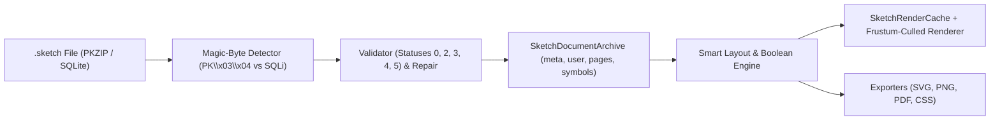

# OpenSketch Technical Overview

This document provides a concise architectural summary of how OpenSketch reads, validates, repairs, lays out, renders, and exports `.sketch` (`v139`) documents across macOS ([`OpenSketch/`](OpenSketch/)) and Windows ([`OpenSketchWindows/`](OpenSketchWindows/)). For the full chronological reverse-engineering log and test notes, see [`FINDINGS.md`](FINDINGS.md).

---

## 1. End-to-End Pipeline

---

## 2. `.sketch` Archive Format (`v139` / `0x8b`)

Modern `.sketch` files are standard PKZIP archives containing JSON members and binary assets:

| Archive Member | Purpose |
|---|---|
| `meta.json` | Archive header (`version: 139`, `compatibilityVersion: 99`, `coeditCompatibilityVersion: 139`, page/artboard summary) |
| `user.json` | Per-user UI state (scroll origin, zoom value, page list height) |
| `document.json` | Root `MSImmutableDocumentData` with `currentPageIndex`, shared styles, and `pages` array of `MSJSONFileReference`s |
| `pages/<UUID>.json` | Individual `MSImmutablePage` layer trees (`artboard`, `symbolMaster`, `symbolInstance`, `shapeGroup`, `rectangle`, `oval`, `text`, etc.) |
| `images/<SHA1>.png` | Embedded bitmap assets referenced via `MSJSONFileReference` |
| `previews/preview.png` | Document thumbnail preview |

### Validation State Machine (`SketchDocumentIO.validate`)

| Status Code | Condition | Behavior |
|---|---|---|
| `0` (`Valid`) | `meta.json` and `user.json` present, `88 <= version <= 139`, `compatibilityVersion <= 139` | Opens normally |
| `2` (`CorruptMetadata`) | `meta.json` or `user.json` missing/corrupt | Prompts recovery; `-repair` synthesizes a clean v139 header and empty `user.json` |
| `3` (`LegacyUnsupported`) | `version <= 87` | Prompts corrupt/legacy warning |
| `4` (`NewerVersionWarning`) | `version > 139` and `compatibilityVersion <= 139` | Prompts data-loss warning; opens if confirmed |
| `5` (`IncompatibleNewer`) | `compatibilityVersion > 139` | Hard error; refuses to open |

> **Why `v2-no-user-json.sketch` silently failed in Sketch 82.1:** Before running `-validate`, Sketch 82.1 queries `+[MSDocumentReader shareInfoForDocumentAtURL:]`, which falls back to reading `user.json` and passes the resulting `nil` `NSData` directly to `+[NSJSONSerialization JSONObjectWithData:options:error:]`, throwing an uncaught `NSInvalidArgumentException`. OpenSketch guards against `nil` member data in `shareInfo` so missing `user.json` archives cleanly reach validation status `2` and auto-repair.

---

## 3. Vector Geometry, Booleans & Smart Layout

1. **Unit-Coordinate Bezier Builder (`SketchBezierBuilder`)**:
   - Curve points in `.sketch` JSON are stored in normalized `[0..1]` unit coordinates (`"{x, y}"`) relative to the layer's `frame`.
   - Straight corners with `cornerRadius > 0` or `fixedRadius > 0` are filleted into cubic Bezier arcs using the exact control-point handle weight `0.4477152502` (`1 - 4*(sqrt(2)-1)/3`).
2. **Boolean Operations (`SketchBooleanEngine`)**:
   - Supports `Union (0)`, `Subtract (1)`, `Intersect (2)`, and `Difference (3)` both non-destructively (via `shapeGroup` subpaths) and destructively (`flattenShapeGroup`).
3. **Smart Layout (`SketchSmartLayoutEngine`)**:
   - Evaluates `MSImmutableInferredGroupLayout` (`axis: 0` horizontal / `axis: 1` vertical; `layoutAnchor: 0` start / `1` center / `2` end).
   - When a `symbolInstance` applies a `<objectID>_stringValue` text override, OpenSketch measures the text width delta, shifts sibling layers along the layout axis whose `minX >= overriddenLayer.maxX`, and expands the instance container.

---

## 4. Caching & Rendering Architecture

To keep interactive pan, zoom, and dragging responsive on multi-artboard documents, `SketchRenderCache` caches four expensive intermediate representations:
- **Pre-decoded RGBA bitmaps** (`images/<hash>.png` decoded once instead of per-frame).
- **$O(1)$ `symbolMaster` lookup table** indexed by `symbolID`.
- **Expanded `symbolInstance` subtrees** keyed by `(documentID, instanceID, symbolID, frameSize, overridesHash)`.
- **Constructed vector paths & text runs** keyed by layer geometry and style.

Combined with **viewport frustum culling** (skipping artboards and layers outside `visibleCanvasRect`), this reduces warm full-canvas frame render times on `samples/smart-layout.sketch` from ~38 ms (uncached) to **2.03 ms** on macOS CoreGraphics and **0.33 ms** on the Rust software rasterizer.
